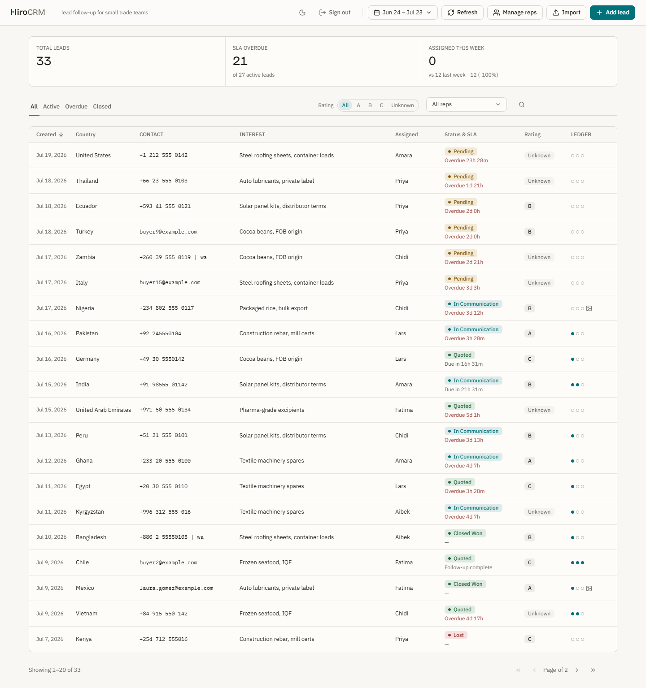
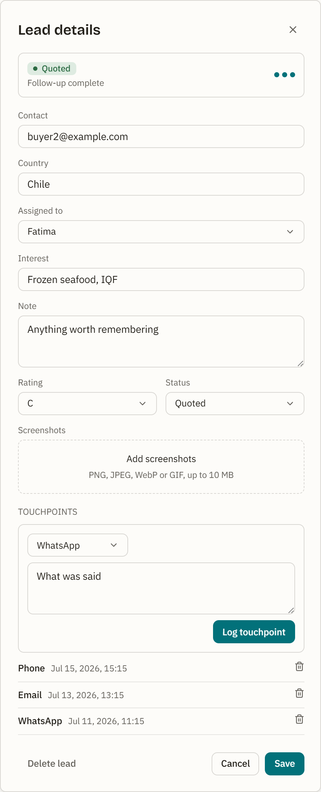

# HiroCRM


Ultra-lightweight, self-hostable CRM for small foreign-trade teams.

<picture>
  <source media="(prefers-color-scheme: dark)" srcset="screenshots/dashboard-dark.png">
  
</picture>

Lead detail with the follow-up touchpoint timeline:



## Features

- **Leads with international contact handling** — phone/email/WhatsApp
  contacts, with automatic dedup so the same buyer can't be entered twice.
- **Follow-up touchpoints** — log every contact with a lead and track its
  history.
- **Configurable follow-up SLA** — a first-response window, a follow-up
  window, and a response cap, all tunable via environment variables.
- **Dashboard with filters, KPIs, and views** — see leads by status, SLA
  state, and date range at a glance.
- **xlsx import** — bring in leads in bulk from a spreadsheet.
- **Screenshot uploads** — attach chat/email screenshots to a lead.
- **Single-admin auth** — one operator account, no user management overhead.
- **One SQLite file** — the entire dataset lives in a single `dev.db` file;
  no external database service to run or maintain.

## Trust model

HiroCRM uses **one shared admin credential** for the whole team — there is no
per-person login. That means, deliberately:

- No per-person identity or individual login.
- No way to revoke a single person's access without changing the shared
  credential for everyone.
- No per-action attribution or audit trail — nothing records *which* person
  using the shared login made a given change.
- No roles or permissions — everyone who signs in has the same access.
- No MFA boundary.

Rep rows (see [Manage reps](#manage-reps)) are just labels for which lead is
assigned to whom. They are not logins or accounts, aren't password-protected,
and don't map to who is actually at the keyboard using the shared credential
at any given moment.

## Quick start

Requires Node 24 (`>=24.17.0 <25`).

```bash
git clone https://github.com/HiroHyun/HiroCRM.git
cd HiroCRM
cp .env.example .env
# then edit .env and fill in ADMIN_USER, ADMIN_PASS, NEXTAUTH_SECRET
# generate a secret with:
#   openssl rand -base64 32
# or:
#   node -e "console.log(require('crypto').randomBytes(32).toString('base64'))"
npm ci
npm run dev
```

`npm run dev` starts the development server for a first look. For a production
deployment — `npm run build` followed by `npm run start` — see
[Supported production setup](#supported-production-setup).

The database initializes itself on first run — there is no manual migration
step to run.

**A fresh install starts empty.** Nothing seeds automatically during install,
build, or start. To fill the dashboard with fictional demo data so you can see
the app working, run `npm run seed` before `npm run dev`. Skip it to begin with
your own leads.

## First run

1. Copy `.env.example` to `.env` and fill in the required variables (see
   [Configuration](#configuration) below).
2. Run `npm run dev` and sign in with the `ADMIN_USER` / `ADMIN_PASS` you set
   in `.env`. You land on an empty dashboard.
3. Optionally run `npm run seed` first. It loads roughly 40 fictional
   international leads across a six-person rep roster, covering every status
   and every follow-up-SLA state, a handful with screenshots attached, and a
   few deliberately old leads that give `npm run retention` something to act
   on. Every name, contact, and screenshot in it is invented.

To reset the demo data at any point, run `npm run seed -- --reset`. The seed
script refuses to run against a database that already has leads unless
`--reset` is passed; with `--reset` it wipes all leads and touchpoints (and
their uploaded screenshot files), clears the rep roster, and reseeds from
scratch.

## Configuration

All variables are read from `.env` (copy `.env.example` to start).

| Variable | Required | Default | Meaning |
| --- | --- | --- | --- |
| `ADMIN_USER` | yes | — | Login username. With this unset, authentication refuses everyone. |
| `ADMIN_PASS` | yes | — | Login password. With this unset, authentication refuses everyone. |
| `NEXTAUTH_SECRET` | yes | — | JWT signing secret for NextAuth sessions. Generate with `openssl rand -base64 32`. |
| `NEXTAUTH_URL` | no | `http://localhost:3000` | Public origin the app is served from; set this when serving on any other host or port so auth callbacks resolve correctly. |
| `SLA_FIRST_RESPONSE_HOURS` | no | `72` | Hours allowed before a lead's first touchpoint is due. |
| `SLA_FOLLOW_UP_HOURS` | no | `120` | Hours allowed between a touchpoint and the next one being due. |
| `SLA_RESPONSE_CAP` | no | `3` | Number of touchpoints after which a lead's SLA clock stops (considered complete). |

## Data & backups

All application data lives in a single SQLite file, `dev.db`, at the project
root (with `-wal` and `-shm` sidecar files while the app is running). Uploaded
screenshots live under the git-ignored `data/uploads/` directory — outside
Next's `public/` tree. The session-guarded `GET /uploads/[name]` route serves
screenshots to authenticated requests. Both `dev.db` (and its sidecars) and
`data/uploads/` are git-ignored.

Back up and restore these as **one atomic set**: the SQLite trio (`dev.db`,
`dev.db-wal`, `dev.db-shm`, or an equivalent SQLite-level backup) together
with the `data/uploads/` directory. Restoring only one half leaves you with
either orphaned upload files or leads whose screenshot references point at
nothing. Shut down the app before backing up, so the write-ahead log is
checkpointed into the main `dev.db` file first.

## Supported production setup

[`OPERATIONS.md`](OPERATIONS.md) is the full production guide — systemd unit,
backup and restore drill, retention scheduling, and upgrade procedure. The
short version:

- Requires Node 24, `>=24.17.0 <25` (see `engines` in `package.json`).
- Build and run with `npm run build` followed by `npm run start` — `npm run
  dev` is for local development only.
- Check the build host's `NODE_ENV` before installing: with
  `NODE_ENV=production` set, `npm ci` and `npm install` omit the
  devDependencies the build itself needs (the Tailwind PostCSS plugin,
  TypeScript). On such hosts install with `npm ci --include=dev`, then build.
- Put HiroCRM behind a reverse proxy that terminates HTTPS whenever it's
  reachable beyond a fully trusted private network.
- Run the process under a supervisor (`systemd`, `pm2`, or similar) so it
  restarts automatically on crash and on host reboot.
- The process needs a persistent, writable filesystem for `dev.db` (plus its
  `-wal`/`-shm` sidecars) and for `data/uploads/`, with filesystem
  permissions that let the process user read and write both. Ephemeral or
  serverless filesystems — where local disk writes don't survive a restart
  or a new instance — are **not supported**; HiroCRM assumes a persistent,
  single-instance filesystem. Run one instance per database file.

## Retention

`scripts/retention.mjs` is an optional cleanup sweep — it does nothing unless
you run it yourself or schedule it. It is **dry-run by default**: without
`--apply` it only prints the plan it would execute and writes nothing. Always
do a dry run first. Pass `--apply` to actually perform the changes.

It runs three phases, in order:

1. **Delete** — leads archived at least `--delete-days` ago (default `1825`)
   are deleted outright, along with their touchpoints and screenshot files.
2. **Strip** — leads archived at least `--image-days` ago (default `365`,
   and not already caught by phase 1) keep their row but have their
   screenshots removed.
3. **Orphan sweep** — files under `data/uploads/` that no lead references
   and are older than 24 hours are removed.

For interactive use:

```bash
npm run retention            # dry run — prints the plan, changes nothing
npm run retention -- --apply # actually delete/strip/unlink
```

To schedule it weekly with cron, use something like:

```
0 3 * * 0 cd /srv/HiroCRM && /usr/bin/node scripts/retention.mjs --apply >> /var/log/hirocrm-retention.log 2>&1
```

The `cd` and the absolute path to `node` are both necessary here: cron jobs
don't run with your project as the working directory, and a bare `npm` may
not be on cron's `PATH`, so the command has to be fully self-contained.

## Manage reps

Every lead is assigned to a rep, tracked in a small roster (name, active
state, and how many leads currently point at it). Open the manage-reps
dialog from the header to:

- **Add** a rep by name.
- **Rename** a rep — case-insensitive duplicate names are rejected.
- **Deactivate / reactivate** a rep — a deactivated rep stays assigned to its
  existing leads and keeps its history, but drops out of the "assign to"
  picker when adding or editing leads.
- **Merge** one rep into another — every lead assigned to the source rep
  moves to the target, then the source rep is removed. Useful for
  consolidating duplicates, e.g. an import that typo-split one rep's name
  into two roster entries.
- **Delete** a rep outright — only allowed once it has zero assigned leads.

## FAQ

**I rotated `NEXTAUTH_SECRET` and now I'm logged out / see a
`JWT_SESSION_ERROR` in the log.** Expected — rotating the secret invalidates
existing sessions. It's a one-time error; just sign in again.

**I'm serving this on a domain other than `localhost`, and auth is broken.**
Set `NEXTAUTH_URL` to your public origin (e.g.
`https://crm.example.com`) so auth callbacks resolve correctly.

**Where does my data live?** See [Data & backups](#data--backups) — a single
`dev.db` file plus `data/uploads/`.

**How do I reset the demo data?** `npm run seed -- --reset`.

**Why only one admin account?** HiroCRM is deliberately single-admin — it's
built for one small team with one shared login, not a multi-user permission
system. See [Trust model](#trust-model) for exactly what that does and
doesn't give you.

**`npm audit` reports advisories.** Two advisory families remain, both upstream
pins this repository cannot move, and both covered in full in
[`SECURITY.md`](SECURITY.md). One is the `postcss` copy that Next.js bundles
internally — one moderate and one high advisory — which runs at build time on
this repository's own stylesheets. The other is the `esbuild` copy that
`drizzle-kit` reaches through its deprecated `@esbuild-kit/*` dependencies, a
development tool that never runs in a deployment; `npm audit --omit=dev` drops
it from the report for that reason. Each clears when its upstream package ships
a release carrying the fixed version.

Earlier advisories against `xlsx` and `sharp` are resolved: `xlsx` installs
from `vendor/xlsx-0.20.3.tgz`, a committed copy of SheetJS's official 0.20.3
tarball (the npm registry copy stops at 0.18.5), and an `overrides` entry holds
`sharp` at the patched 0.35 line. `SECURITY.md` records both resolutions.

**`npm run build` is failing without network access.** `next/font/google` is
used for web fonts, and `npm run build` fetches them at build time, so build
requires network access. Running in dev or serving an already-built app does
not.

## Tech stack

- [Next.js](https://nextjs.org/) (App Router) + [React](https://react.dev/)
- [better-sqlite3](https://github.com/WiseLibs/better-sqlite3) +
  [Drizzle ORM](https://orm.drizzle.team/)
- [NextAuth](https://next-auth.js.org/)
- [Base UI](https://base-ui.com/)
- [Tailwind CSS](https://tailwindcss.com/) v4
- [vitest](https://vitest.dev/) for tests

Every dependency resolves to an exact, locked version and the lockfile is
committed, so a fresh `npm ci` installs the combination the test suite actually
ran against. Two entries in `package.json` look unusual on purpose: `xlsx`
installs from `vendor/xlsx-0.20.3.tgz`, a copy of SheetJS's official 0.20.3
tarball committed to this repository and verified by sha512 against the CDN
integrity the lockfile previously recorded, so `npm ci` needs no SheetJS
infrastructure; and an `overrides` entry holds the `sharp` package Next.js
installs at the patched 0.35 line. Version bumps are deliberate work reviewed
against the full gate; `dependabot.yml` ships with `open-pull-requests-limit: 0`
as a release-time choice, so raise that limit when you want version-update pull
requests to resume. See `package.json` for exact versions.

## Development

`npm run gate` must pass before any change lands. It runs, in order: a
production build, ESLint, the vitest unit suite, a UI copy and design-token
check, and an API smoke suite that boots a real server against a scratch
database. CI runs that same command on every pull request.

[`CONTRIBUTING.md`](CONTRIBUTING.md) covers setup and contribution terms.

Useful scripts:

| Script | Purpose |
| --- | --- |
| `npm run dev` | Start the dev server. |
| `npm run build` | Production build. |
| `npm run start` | Run a production build. |
| `npm run lint` | Lint the codebase. |
| `npm run test` | Run the test suite. |
| `npm run check:copy` | Verify UI copy conventions. |
| `npm run smoke` | Run API smoke tests. |
| `npm run seed` | Seed the database with demo data. |
| `npm run retention` | Run the retention sweep (dry run by default). |
| `npm run gate` | Run build + lint + test + `check:copy` + `smoke` together. |

## Support boundaries

HiroCRM v0.1.1 is an early public preview, maintained by one person. What that
means concretely:

- One shared administrator credential, described in
  [Trust model](#trust-model). Run it for one operator or a small mutually
  trusted team.
- Persistent single-instance filesystem only. Ephemeral and serverless
  platforms are unsupported.
- The database schema may change between preview releases, and no migration
  path between them is guaranteed yet.
- Security reports go through the private reporting path in
  [`SECURITY.md`](SECURITY.md).

## License

Apache-2.0 — see [`LICENSE`](LICENSE) and [`NOTICE`](NOTICE). Third-party
asset and dependency provenance is recorded in
[`THIRD_PARTY_NOTICES.md`](THIRD_PARTY_NOTICES.md).

What the license does in practice: Apache-2.0 gives you copyright permission
to use, modify, and redistribute this work, adds an express patent grant
covering patent claims its contributors control, and terminates that grant for
anyone who starts patent litigation over the work. Publishing this repository
also creates dated public evidence of the work. Neither of those protects you
from patent claims held by unrelated third parties, and neither is a
substitute for your own legal advice.
